# Projet O.R.I.O.N — Taux d'acceptation des demandes d'asile africaines en Europe


**O.R.I.O.N** (*Observatoire des Réponses et Indicateurs de l'Octroi en Niveau d'asile*) est un projet data qui cherche à expliquer pourquoi les **taux d'acceptation des demandes d'asile africaines** varient autant d'un pays européen à l'autre. Il s'appuie sur **1 239 953 décisions de première instance** rendues entre **2015 et 2023** et sur six sources officielles : UNHCR, Eurostat et EM-DAT.

> Projet réalisé par **Ornella Fangnon** dans le cadre du Bachelor Data & BI, Nexa Digital School. Le contexte (département Data & Analyse stratégique du HCR, Bureau Europe) est fictif mais réaliste.

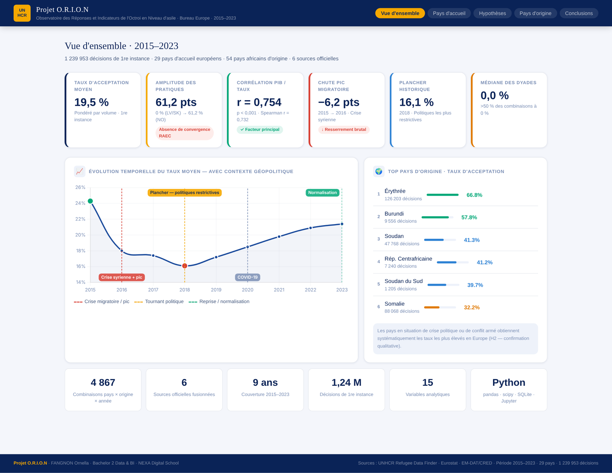

---

## Sommaire

- [Problématique et hypothèses](#problématique-et-hypothèses)
- [Résultats clés](#résultats-clés)
- [Interprétation des résultats](#interprétation-des-résultats)
- [Aperçus](#aperçus)
- [Données](#données)
- [Pipeline et méthodologie](#pipeline-et-méthodologie)
- [Machine learning](#machine-learning)
- [Structure du dépôt](#structure-du-dépôt)
- [Installation et utilisation](#installation-et-utilisation)
- [Limites et pistes d'amélioration](#limites-et-pistes-damélioration)
- [Auteure et licence](#auteure-et-licence)

---

## Problématique et hypothèses

> **Pourquoi les taux d'acceptation des demandes d'asile africaines varient-ils entre les pays européens ?**

Sur 2015–2023, le taux moyen d'acceptation est de **19,5 %**, mais il va de **0 %** en Lettonie et en Slovaquie à **61,2 %** en Norvège. Quatre hypothèses sont testées :

| | Hypothèse |
|---|---|
| **H1** | Les pays qui reçoivent beaucoup de demandes ont des taux plus faibles (effet de saturation) |
| **H2** | Les demandeurs venant de pays africains en crise obtiennent des taux plus élevés |
| **H3** | Les taux varient selon les périodes de pression migratoire |
| **H4** | Les pays d'accueil plus riches acceptent proportionnellement plus de demandes |

## Résultats clés

| Hypothèse | Statistique | Verdict |
|---|---|---|
| H1 — Volume → taux plus faible | r = 0,022 (p = 0,739) | ❌ Infirmée |
| H2 — Pays en crise → taux plus élevé | r = −0,016 (p = 0,731) | ⚠️ Partielle |
| H3 — Effet temporel | écart de 8,2 points sur 2015–2023 | ✅ Confirmée |
| H4 — PIB élevé → taux plus élevé | r = 0,754 (Pearson) · 0,732 (Spearman), p < 0,001 | ✅ Confirmée |

| Indicateur | Valeur |
|---|---|
| Décisions analysées (1re instance) | 1 239 953 |
| Combinaisons pays d'accueil × pays d'origine × année | 4 867 |
| Taux d'acceptation moyen (pondéré par le volume) | 19,5 % |
| Pays le plus accueillant / le plus restrictif | Norvège 61,2 % / Lettonie et Slovaquie 0 % |
| Taux moyen des pays à PIB élevé / faible | 40,2 % / 8,9 % |

## Interprétation des résultats

### 1. Une Europe de l'asile très fragmentée
Malgré un cadre juridique commun (le Régime d'asile européen commun, RAEC), un même demandeur africain a des chances très différentes selon le pays où il dépose sa demande. Trois groupes se dessinent :
- **Pays très accueillants (39 à 61 %)** : Norvège, Danemark, Luxembourg, Belgique, Pays-Bas ;
- **Pays intermédiaires (20 à 38 %)** : Suède, Finlande, Suisse, Allemagne, Grèce, Irlande, France ;
- **Pays très restrictifs (0 à 7 %)** : Italie, Pologne, Croatie, Hongrie, Bulgarie, Slovénie, Lettonie, Slovaquie.

La **médiane des combinaisons est de 0 %** : dans plus de la moitié des couples pays d'accueil × pays d'origine × année, aucune demande n'a été acceptée. Certains pays refusent donc quasi systématiquement certaines nationalités.

### 2. Le niveau de richesse du pays d'accueil est le facteur le plus déterminant (H4)
C'est le résultat le plus solide de l'analyse : **r = 0,754** entre le PIB par habitant et le taux d'acceptation, confirmé par la corrélation de rang de Spearman (0,732). Les pays du tiers le plus riche acceptent **40,2 %** des demandes, contre **8,9 %** pour le tiers le moins riche, soit 31 points d'écart. Les capacités d'accueil (logement, emploi, services sociaux) semblent conditionner les décisions. Mais une corrélation ne prouve pas une causalité : les traditions juridiques, l'orientation politique des gouvernements ou les réseaux de diaspora jouent sans doute aussi, et ils sont eux-mêmes liés à la richesse.

### 3. Les politiques d'asile réagissent aux crises migratoires (H3)
Le taux chute de **24,3 % en 2015 à 18,0 % en 2016** (−6,2 points) pendant le pic migratoire lié à la crise syrienne. Il atteint un **plancher de 16,1 % en 2018**, l'année des politiques les plus restrictives (contrôles renforcés, fermeture des ports italiens), puis remonte progressivement jusqu'à **21,4 % en 2023**. Quand la pression migratoire monte, les États resserrent leurs critères d'acceptation, puis les assouplissent une fois la crise passée.

### 4. Le volume de demandes n'explique rien (H1)
Contrairement à l'intuition, recevoir beaucoup de demandes ne rend pas un pays plus sévère (r = 0,022, non significatif). La **France**, premier pays de destination (377 622 décisions), maintient un taux stable d'environ 21 %. L'**Italie**, au volume presque identique (370 135 décisions), n'accepte que 6,7 % des demandes. À volume égal, les choix politiques nationaux font la différence.

### 5. La situation du pays d'origine compte, mais l'indicateur choisi ne le montre pas (H2)
Statistiquement, aucun lien n'apparaît entre le nombre de catastrophes recensées par EM-DAT et le taux d'acceptation (r = −0,016). Pourtant, les nationalités fuyant des conflits ou des persécutions obtiennent les taux les plus élevés : **Érythrée 66,8 %**, **Burundi 57,8 %**, **Soudan 41,3 %**, **Somalie 32,2 %**. L'écart s'explique par l'indicateur : EM-DAT recense les catastrophes naturelles et technologiques, pas les **conflits armés ni les persécutions politiques**, qui sont pourtant les motifs reconnus par la Convention de Genève. H2 reste donc plausible, mais il faudrait un indicateur de conflits (ACLED) pour la démontrer.

### 6. Ce que révèle le machine learning
Les modèles entraînés sur les variables disponibles (année, volumes, PIB, catastrophes) prédisent mal le taux d'une combinaison donnée : la **régression linéaire atteint un R² de 0,01**, et le meilleur KNN (exactitude 0,68) ne fait pas mieux qu'un modèle qui répondrait toujours « taux faible » (69 % des cas). Ce n'est pas un échec : la corrélation forte de H4 apparaît **entre pays**, mais au niveau de chaque couple pays d'accueil × pays d'origine, la **nationalité du demandeur** domine. Or elle ne figure pas parmi les variables du modèle. La prochaine itération devra l'intégrer, avec un indicateur de conflits.

### En résumé
Les écarts entre pays européens s'expliquent d'abord par **le niveau économique du pays d'accueil** et par **la conjoncture migratoire**, pas par le nombre de demandes reçues. La situation du pays d'origine pèse fortement, mais elle reste à mesurer avec des données sur les conflits. Pour le HCR, ces résultats plaident pour une **meilleure harmonisation des pratiques au sein du RAEC** et pour un **soutien ciblé aux pays d'accueil aux capacités économiques plus faibles**.

## Aperçus

**Dashboard HTML interactif** ([`dashboard/ORION_Dashboard.html`](dashboard/ORION_Dashboard.html), à ouvrir dans un navigateur)

| Pays d'accueil | Test des hypothèses |
|---|---|
| 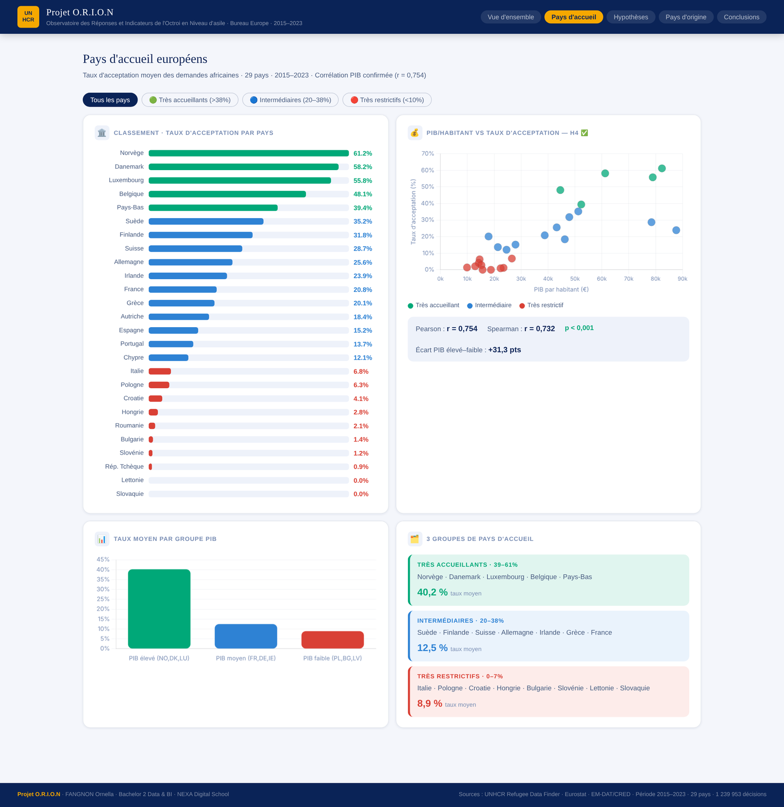 | 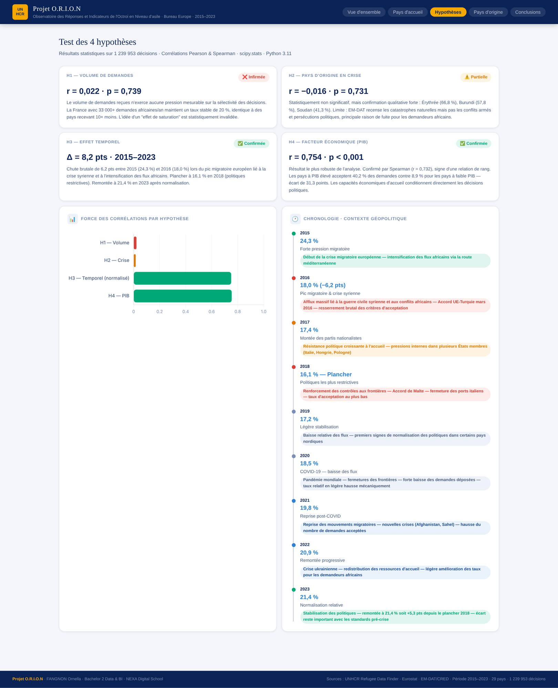 |

| Pays d'origine | Conclusions |
|---|---|
| 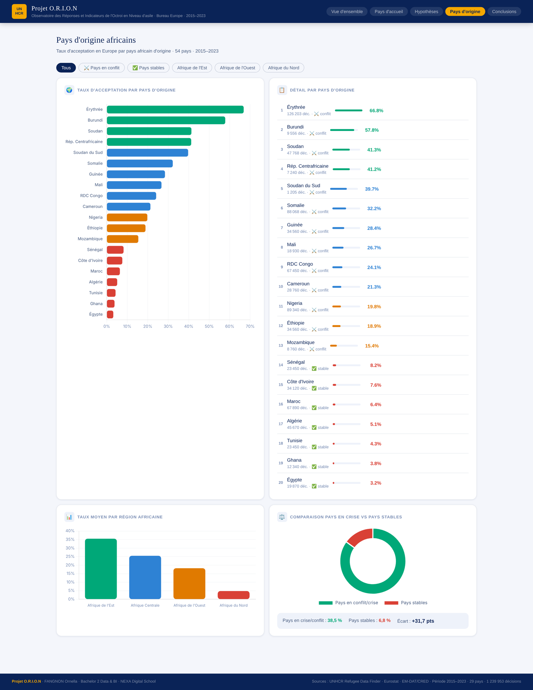 | 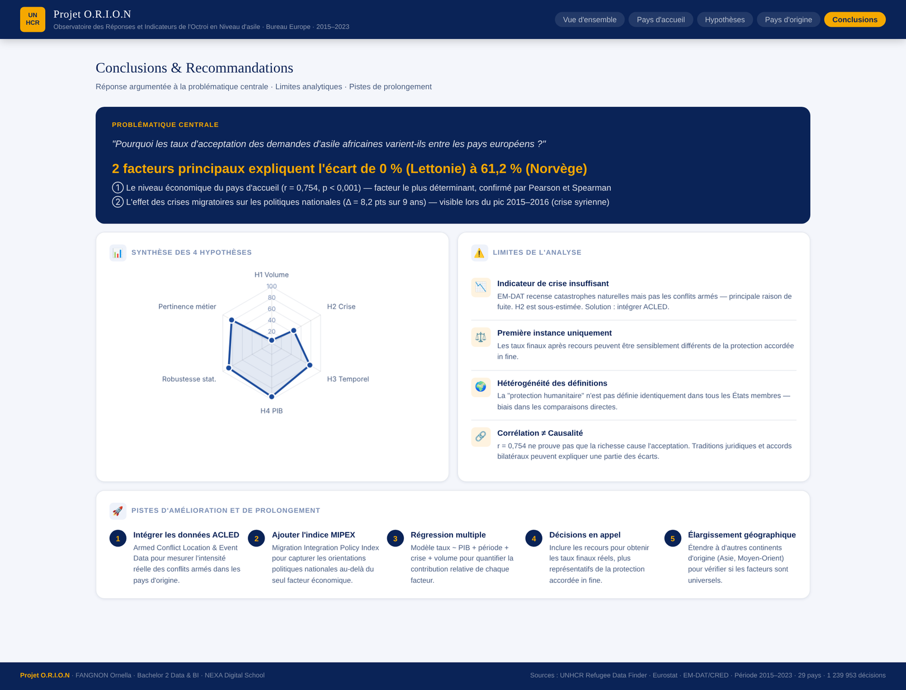 |

**Application Streamlit (machine learning)**

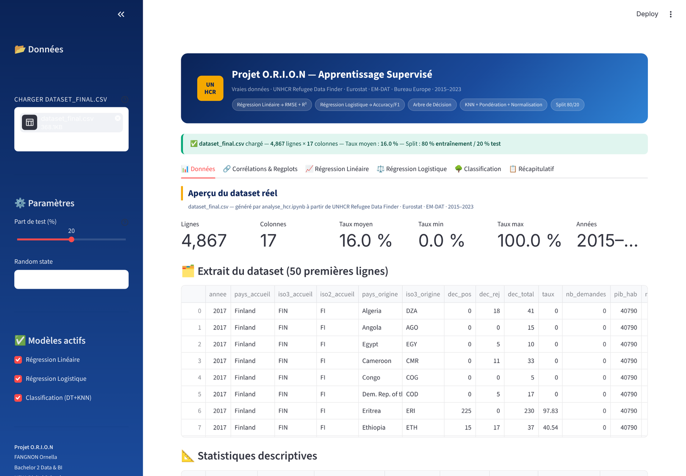

**Graphiques d'analyse (notebook)**

| Taux par pays d'accueil | Heatmap pays × année |
|---|---|
| 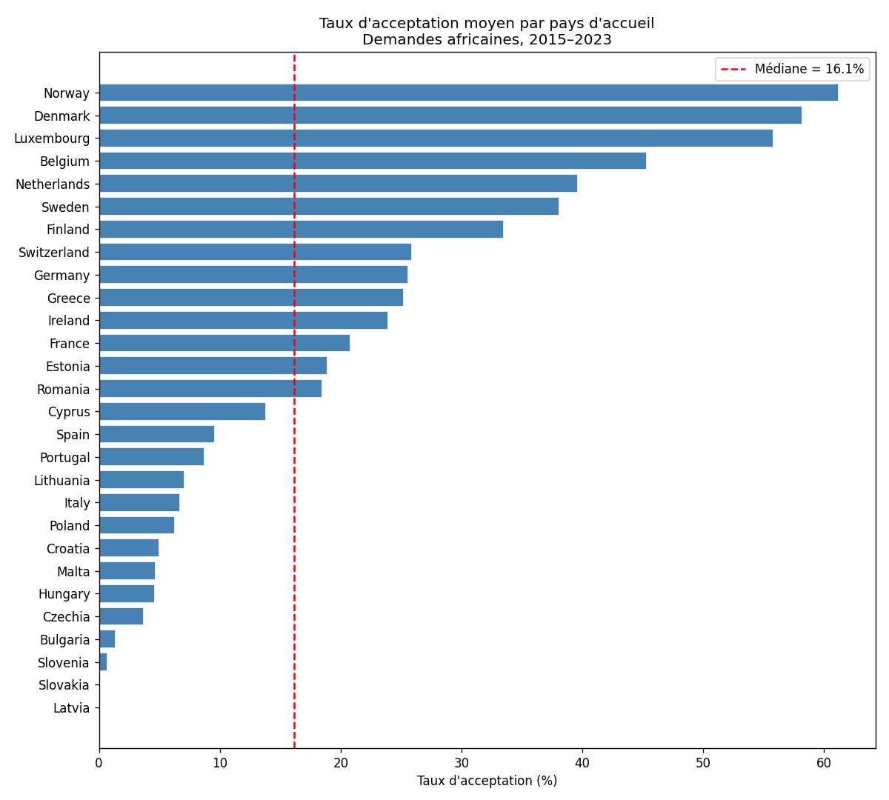 | 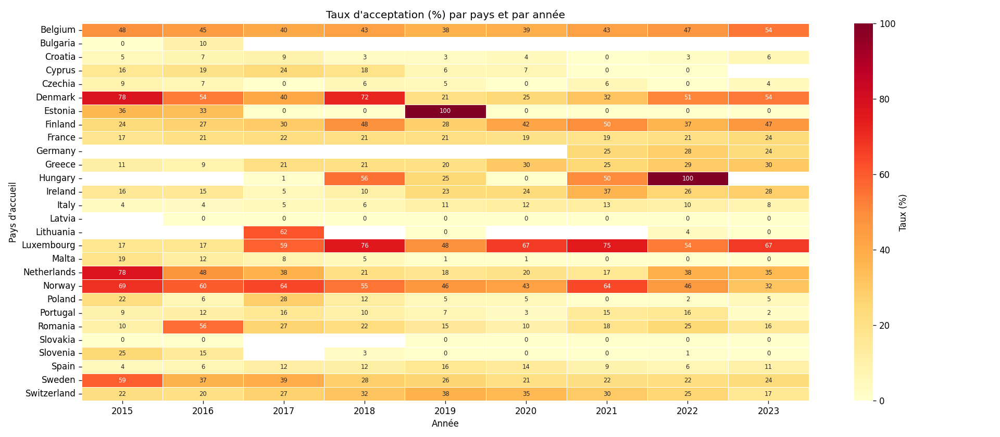 |

| H1 — Volume | H2 — Crises |
|---|---|
| 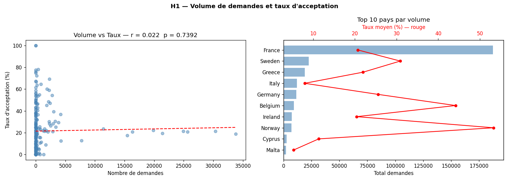 | 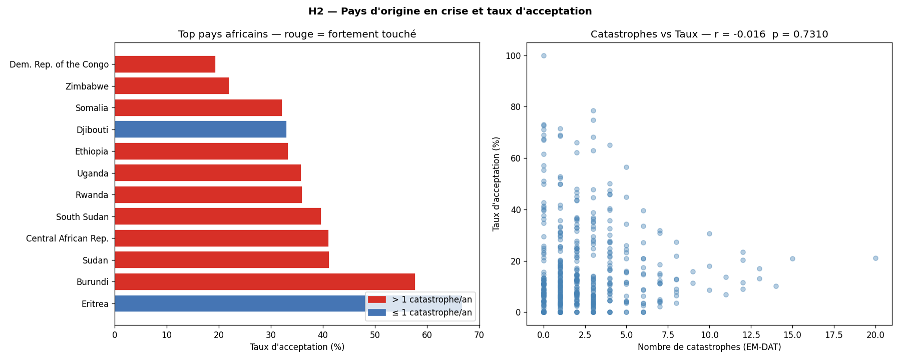 |

| H3 — Évolution | H4 — PIB |
|---|---|
| 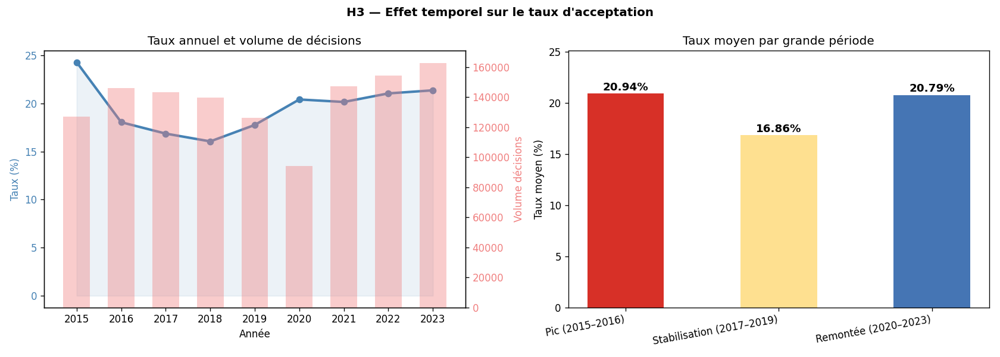 | 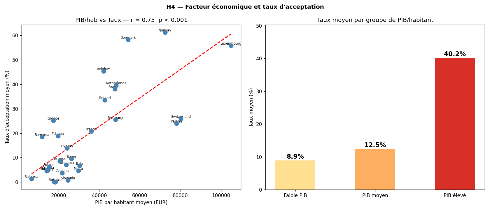 |

## Données

| Fichier (`data/raw/`) | Source | Contenu |
|---|---|---|
| `HCR_decision_d_asile.zip` | [UNHCR Refugee Data Finder](https://www.unhcr.org/refugee-statistics/) | Décisions d'asile 2000–2025 (112 498 lignes) |
| `HCR_demande__d_asile.zip` | UNHCR Refugee Data Finder | Demandes d'asile 2000–2025 (119 139 lignes) |
| `HCR_chiffre_population.zip` | UNHCR Refugee Data Finder | Personnes relevant du mandat 1951–2025 |
| `Eurostat_PIB_par_Habitant_UE.gz` | Eurostat — [NAMA_10_PC](https://ec.europa.eu/eurostat/databrowser/view/nama_10_pc/default/table) | PIB par habitant (EUR courants) |
| `Eurostat_PIB_UE.gz` | Eurostat — [NAMA_10_GDP](https://ec.europa.eu/eurostat/databrowser/view/nama_10_gdp/default/table) | PIB total |
| `emdat.xlsx` | [EM-DAT / CRED](https://www.emdat.be/) (UCLouvain) | Catastrophes naturelles et technologiques |
| `complementaires/` | Eurostat — SPR_EXP_TYPE, LFSA_URGANEDM, LFSA_ERGANEDM | Protection sociale, taux de chômage et d'emploi (évalués, non retenus) |

**Périmètre** : 2015–2023 · pays d'accueil EU27 + Norvège + Suisse · 54 pays africains d'origine · décisions de première instance (FI), procédure générale (G).

Les tables nettoyées sont dans [`data/cleaned/`](data/cleaned/) : `dataset_final.csv` (4 867 lignes × 15 colonnes), `decisions_clean.csv`, `demandes_clean.csv`, `pib_clean.csv`, `crises_clean.csv`, plus la base SQLite `hcr.db`.

## Pipeline et méthodologie

```
Sources brutes ──► Nettoyage (pandas) ──► SQLite ──► Fusion ──► Analyse ──► Restitution
ZIP · GZ · XLSX    filtres, ISO-3/ISO-2,   hcr.db     dataset    Pearson,     notebook,
(lus sans          taux pondéré                        final      Spearman,    dashboard HTML,
 extraction)                                                      ML           app Streamlit
```

1. **Chargement** : les archives ZIP et GZ sont lues directement (`zipfile`, `gzip`), et le fichier EM-DAT avec `openpyxl`.
2. **Filtrage** : années 2015–2023, pays d'accueil européens, pays d'origine africains, première instance, procédure générale, suppression des lignes où `dec_total = 0`.
3. **Harmonisation** : table de correspondance ISO-3 → ISO-2 (cas de la Grèce, codée `EL` chez Eurostat) et nettoyage des noms de pays.
4. **Variable cible** : taux d'acceptation **pondéré par le volume**, soit Σ décisions positives / Σ décisions × 100. On évite ainsi de surpondérer les combinaisons à faible effectif.
5. **SQL** : chargement dans SQLite et requêtes d'agrégation et de jointure ([`sql/requetes.sql`](sql/requetes.sql)).
6. **Tests statistiques** : corrélations de Pearson et Spearman (`scipy.stats`), puis comparaisons par groupes et par périodes.

## Machine learning

L'application [`app/app_orion.py`](app/app_orion.py) entraîne plusieurs modèles `scikit-learn` sur `dataset_final.csv`, avec un découpage 80/20 et des pipelines incluant la normalisation :

| Modèle | Cible | Résultats |
|---|---|---|
| Régression linéaire | taux (continu) | RMSE = 25,8 · R² = 0,01 |
| Régression logistique | taux ≥ 20 % (binaire) | Accuracy = 0,60 · F1 = 0,36 |
| Arbre de décision | Faible / Modéré / Élevé | Accuracy = 0,41 · F1 = 0,43 |
| KNN uniforme (k = 7) | Faible / Modéré / Élevé | Accuracy = 0,68 · F1 = 0,61 |
| KNN pondéré normalisé (k = 5) | Faible / Modéré / Élevé | Accuracy = 0,64 · F1 = 0,61 |

Ces scores sont discutés dans l'[interprétation](#6-ce-que-révèle-le-machine-learning).

## Structure du dépôt

```
PROJET-HCR/
│
├── notebooks/
│   └── analyse_hcr.ipynb          # Notebook principal : nettoyage, SQL, tests H1–H4
│
├── app/
│   ├── app_orion.py               # Application Streamlit (machine learning)
│   └── models_orion.py            # Chargement des données, modèles, métriques
│
├── dashboard/
│   └── ORION_Dashboard.html       # Dashboard interactif (Chart.js)
│
├── sql/
│   └── requetes.sql               # Requêtes SQL commentées (H1 à H4)
│
├── data/
│   ├── raw/                       # Sources brutes (UNHCR, Eurostat, EM-DAT)
│   │   └── complementaires/       # Sources évaluées mais non retenues
│   └── cleaned/                   # Tables nettoyées + base SQLite hcr.db
│
├── images/                        # Graphiques du notebook et captures
│
├── docs/
│   ├── rapport_projet_orion.pdf   # Rapport complet du projet
│   └── data_dictionary.pdf        # Dictionnaire des données
│
├── requirements.txt
├── README.md
└── LICENSE
```

## Installation et utilisation

```bash
git clone https://github.com/Ornella2005-coder/PROJET-HCR.git
cd PROJET-HCR

python -m venv env
# Windows : env\Scripts\activate     |  Mac / Linux : source env/bin/activate
pip install -r requirements.txt
```

**Notebook** : ouvrir `notebooks/analyse_hcr.ipynb` (VS Code ou Jupyter), puis cliquer sur **Run All**. Les tables sont régénérées dans `data/cleaned/` et les graphiques dans `images/`.

**Application Streamlit** :
```bash
python -m streamlit run app/app_orion.py
```
Puis charger `data/cleaned/dataset_final.csv` depuis la barre latérale.

**Dashboard** : ouvrir `dashboard/ORION_Dashboard.html` dans un navigateur (connexion internet requise pour charger Chart.js).

**Requêtes SQL** : ouvrir `data/cleaned/hcr.db` avec [DB Browser for SQLite](https://sqlitebrowser.org/) et exécuter `sql/requetes.sql`, ou en Python :
```python
import sqlite3, pandas as pd
conn = sqlite3.connect("data/cleaned/hcr.db")
print(pd.read_sql("SELECT * FROM dataset_final LIMIT 5", conn))
```

## Limites et pistes d'amélioration

**Limites**
- **Indicateur de crise inadapté** : EM-DAT ne couvre ni les conflits armés ni les persécutions, si bien que H2 est sous-estimée.
- **Première instance uniquement** : les taux après recours peuvent être sensiblement différents.
- **Définitions hétérogènes** : la notion de « protection humanitaire » varie d'un pays à l'autre.
- **Corrélation ≠ causalité** : la relation entre PIB et taux peut refléter d'autres facteurs (traditions juridiques, orientation politique).
- **Pouvoir prédictif faible** au niveau de chaque combinaison, car la nationalité d'origine n'est pas une variable des modèles.

**Pistes**
- Intégrer **ACLED** (conflits armés) pour retester H2.
- Ajouter l'**indice MIPEX** des politiques migratoires.
- Réaliser une **régression multiple** (taux ~ PIB + période + crise + volume + origine).
- Inclure les **décisions en appel** et étendre l'analyse à d'autres continents d'origine.

## Auteure et licence

**Ornella Fangnon** · Bachelor Data & BI, Nexa Digital School

Code et documentation sous licence [MIT](LICENSE). Les données restent la propriété de leurs producteurs : UNHCR, Eurostat (CC BY 4.0) et EM-DAT / CRED (usage non commercial, citation obligatoire).
